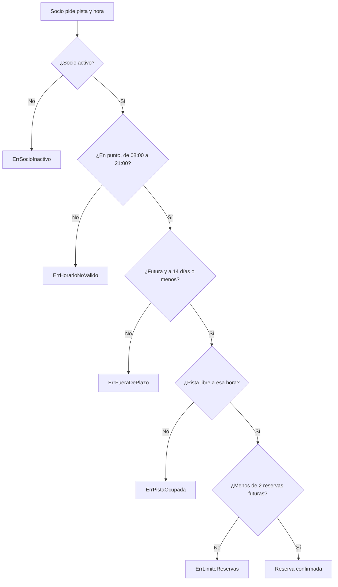

# Flujo de una reserva

Qué pasa desde que un socio pide una pista hasta que recibe la respuesta. Las comprobaciones del dominio están en `internal/dominio`; las que consultan otras reservas, en el caso de uso `ReservarPista`.

